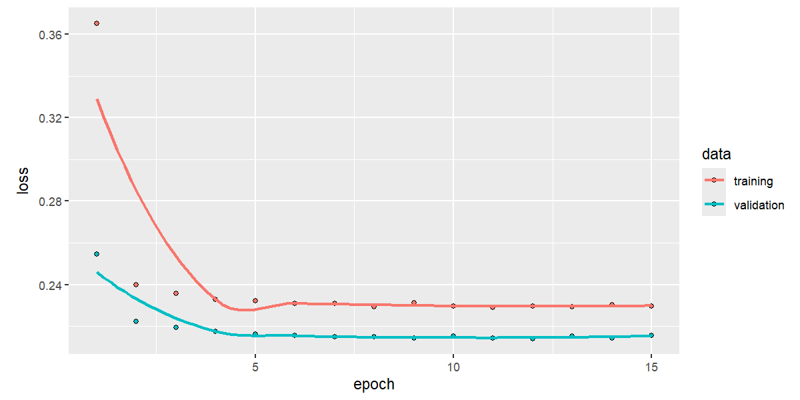

## Introduction

This study utilizes a simulated dataset of 25,000 handwritten digits collected from 20 participants. Each individual provided 1,250 samples split across 5 sessions, with 50 samples recorded per session. Handwritten samples naturally exhibit intra-writer variability due to inherent personal differences and changing environmental conditions, such as time constraints during exams compared to relaxed note-taking. Nevertheless, underlying individual traits remain consistent, enabling writer identification.

To investigate this data set, we address two core questions: first, whether we can identify a writer across different sessions, and second, whether we can determine if two arbitrary handwritten digits belong to the same person.

To investigate the first research question, we will construct a Convolutional Neural Network (CNN) designed to classify handwritten digit images and assign them to one of the 20 individuals in the data set. To explore the second question, we will develop a Siamese neural network to determine whether two given images originate from the same writer or different writers. Finally, these two models will be evaluated and compared to establish which architecture yields superior performance in terms of accuracy and precision.

## Data Splitting

To build and evaluate our models, the dataset is partitioned into three distinct subsets: a training set used to construct the models, a validation set used to evaluate performance and tune hyperparameters, and a test set for final assessment. Rather than splitting randomly, the data is partitioned by session: **Sessions 1 to 3** form the training set, **Session 4** serves as the validation set, and **Session 5** comprises the test set.

This session-based partitioning is intentional. Because the objective is to recognize each person's handwriting across different writing conditions, every participant must be represented in the training data. Furthermore, because both the Convolutional Neural Network (CNN) and the Siamese network are evaluated and compared directly against one another, maintaining a consistent data split ensures a fair performance comparison across both architectures.

## Explanatory Data Analysis

The aim of this section is to explore the handwriting images and metadata, compare examples across people, digits and sessions, and identify visible sources of variation and limitations of the simulated data.

```{r}
#| include: false
library(dplyr)
library(knitr)

data <- readRDS("handwriting.rds")
meta <- data$metadata
X <- matrix(data$images, nrow = 25000) / 255
images <- data$images
set.seed(5073)

# One row per image; the image array is assumed to be ordered like metadata.
stopifnot(dim(images)[1] == nrow(meta))

display_image <- function(img, title = "") {
  # Accept either a 28 x 28 matrix or a 28 x 28 x 1 array.
  if (length(dim(img)) == 3) img <- img[, , 1]
  image(t(img)[, ncol(img):1],
        col = gray.colors(256), axes = FALSE, main = title)
}
```

### Data set and Metadata Overview

```{r}
#| echo: false


# 1. Extract values dynamically from your data structure
unique_subjects <- paste(range(data$metadata$person_id), collapse = " - ")
n_subjects      <- length(unique(data$metadata$person_id))

unique_sessions <- paste(range(data$metadata$session), collapse = " - ")
n_sessions      <- length(unique(data$metadata$session))

unique_digits   <- paste(range(data$metadata$digit), collapse = " - ")
n_digits        <- length(unique(data$metadata$digit))

total_samples   <- nrow(data$metadata)

# Image Dimensions & Color Channels
img_shape       <- dim(data$images)
img_res         <- paste0(img_shape[1], " x ", img_shape[2], " pixels")
color_channels  <- if (length(img_shape) > 2) paste(img_shape[3], "Channel(s)") else "1 (Grayscale)"

# Samples per digit summary string
samples_per_digit <- paste(table(data$metadata$digit), collapse = ", ")

# 2. Construct the Summary Data Frame
metadata_summary <- data.frame(
  `Metadata Attribute` = c(
    "Person ID Range (`person_id`)",
    "Session ID Range (`session`)",
    "Digit Classes (`digit`)",
    "Total Dataset Size ($N$)",
    "Image Resolution (Height x Width)",
    "Color Channels",
    "Class Distribution (Digits 0 to 4)"
  ),
  `Value / Description` = c(
    paste0(unique_subjects, " (", n_subjects, " unique subjects)"),
    paste0(unique_sessions, " (", n_sessions, " distinct sessions)"),
    paste0(unique_digits, " (", n_digits, " classes)"),
    paste0(total_samples, " images"),
    img_res,
    color_channels,
    paste0("Balanced (", samples_per_digit, " samples each)")
  ),
  check.names = FALSE
)

# 3. Render using kable
kable(
  metadata_summary,
  booktabs = TRUE,
  caption = "Summary of Dataset Metadata and Image Dimensions"
)
```

The metadata identify the writer (`person_id`), the digit class (`digit`), and the recording session (`session`). These variables allow us to compare writers while holding the digit and session fixed, compare sessions for the same writer and digit, and compare different digits written by the same person.

### Quantitative meta data analysis

```{r}
#| echo: false
#Building the features

img  <- data$images[,,,1] / 255
feat <- t(apply(img, 1, function(m) {
  on <- m > 0.3
  r  <- which(rowSums(on) > 0)
  cc <- which(colSums(on) > 0)
  c(h = diff(range(r)) + 1, w = diff(range(cc)) + 1,
    cx = sum(m * col(m)) / sum(m), cy = sum(m * row(m)) / sum(m))
}))

#Preparing for analysis

df <- data.frame(meta, feat)
df[c("person_id", "session", "digit")] <- lapply(df[c("person_id", "session", "digit")], factor)

# Variance decomposition
vars <- c("h", "w", "cx", "cy")
res_list <- list()

for (v in vars) {
  ss <- summary(aov(reformulate("digit + person_id + session + person_id:session", v),
                    data = df))[[1]]
  
  # Calculate percentage of variance
  pct <- round(100 * ss[["Sum Sq"]] / sum(ss[["Sum Sq"]]), 1)
  res_list[[v]] <- setNames(pct, trimws(rownames(ss)))
}

# Combine into a data frame and format with kable
res_df <- do.call(rbind, res_list)
rownames(res_df) <- vars

kable(res_df, col.names = c("Digit", "Person ID", "Session", "Person ID : Session", "Residuals"),
      caption = "Percentage of Variance Decomposition for Features")
```

To evaluate the stability and discriminative power of spatial feature measurements across handwritten digit samples, a variance decomposition analysis was conducted. The analysis decomposes total variance across four spatial metrics into five distinct components:

- **Feature Metrics:** Digit height ($h$), digit width ($w$), horizontal center of mass ($cx$), and vertical center of mass ($cy$).

- **Variance Components:** Digit identity (**Digit**), writer identity (**Person ID**), baseline session main effect (**Session**), writer-by-session interaction (**Person ID : Session**), and random residual variation across replicates (**Residuals**).

#### Feature Interpretation

- **Digit Height (**$h$): Writer identity (**Person ID**) accounts for the dominant share of variance at **62.9%**, whereas the interaction effect (**Person ID : Session**) accounts for only **2.9%**. This demonstrates that character height serves as a highly stable, writer-specific trait that remains robust across distinct recording sessions.

- **Digit Width (**$w$): Total variance is primarily partitioned between digit identity (**43.5%**) and writer identity (**40.5%**). Naturally, character width varies intrinsically across different digits (e.g., a digit '1' versus a digit '0'); nevertheless, substantial inter-writer variance persists with minimal session-induced fluctuation (**6.8%**).

- **Horizontal Position (**$cx$): Influenced moderately by both digit identity (**31.6%**) and writer identity (**34.4%**). Individual writers maintain consistent horizontal placement habits, though a moderate writer-by-session interaction (**10.3%**) indicates minor positional shifts across recording instances.

- **Vertical Position (**$cy$): Exhibits poor stability for writer discrimination. Main writer variance accounts for only **10.3%**, whereas writer-by-session interaction (**17.0%**) and residual noise (**57.3%**) dominate total variance. Consequently, vertical alignment varies substantially between sessions and individual stroke replicates, making it an unreliable feature for writer identification.

Overall, the variance decomposition yields several key insights regarding feature stability and writer discriminability. Main session effects contribute less than 1% across all spatial metrics (0.1%–0.6%), indicating that no single recording session exhibits global systematic bias or baseline shift, which supports the assumption that sessions represent comparable sampling conditions. Furthermore, inter-individual variance (**Person ID**) constitutes a major proportion of total variation for height, width, and horizontal positioning, confirming that individual writers possess measurable, repeatable handwriting characteristics that generalize across distinct sessions. Finally, handwriting variations between sessions manifest primarily as spatial positional shifts ($cx, cy$) rather than structural or dimensional resizing ($h, w$).

#### Euclidean Distance Analysis

```{r}
#| echo: false


dist_table <- function(M) {
  d4  <- meta$session %in% 1:4
  key <- with(meta[d4, ], paste(person_id, digit, session))
  Cm  <- rowsum(M[d4, ], key) / 50
  k   <- do.call(rbind, strsplit(rownames(Cm), " "))
  info <- data.frame(p = k[,1], d = k[,2], s = k[,3])
  
  sapply(0:4, function(dd) {
    i <- which(info$d == dd)
    D <- as.matrix(dist(Cm[i, ]))
    a <- info[i, ]
    up <- upper.tri(D)
    sp <- outer(a$p, a$p, "==")
    ss <- outer(a$s, a$s, "==")
    c(same_writer_diff_session = mean(D[up & sp & !ss]),
      diff_writer_same_session = mean(D[up & !sp & ss]),
      diff_writer_diff_session = mean(D[up & !sp & !ss]))
  })
}

dtab <- dist_table(X)
colnames(dtab) <- paste("Digit", 0:4)

# Calculate ratio and combine with the main distance table
ratio_row <- dtab["same_writer_diff_session", ] / dtab["diff_writer_diff_session", ]
combined_matrix <- rbind(round(dtab, 2), ratio = round(ratio_row, 2))

# Rename the final row for clarity
rownames(combined_matrix)[4] <- "Ratio (Same/Diff Writer)"

# Render using kable
kable(combined_matrix, 
      caption = "Euclidean Distances and Ratios Across Digits (0 to 4)")
```

Because distances are measured in pixel units, relative comparisons across conditions are more informative than absolute values (see Table 2). Across all digits (0 to 4), the mean Euclidean distance for the same writer across different sessions ($6.35$–$7.06$ pixels) is consistently smaller than between different writers ($7.85$–$8.79$ pixels), establishing the core signal required for writer identification.

However, this distinction is moderate. The ratio of same-writer to different-writer distance ranges tightly between $0.80$ and $0.83$ across all digits, showing that session-to-session variation accounts for roughly $80\%$ of the distance to another writer's sample. Additionally, distances between different writers are virtually identical within the same session ($7.85$–$8.78$) and across different sessions ($7.85$–$8.79$). This confirms the absence of a shared session effect, directly supporting previous variance decomposition findings ($<1\%$ session variance) and validating the decision to hold out entire sessions for testing.

### Variation between people

Firstly, we will compare all 20 peoples handwriting across one session. The main goal of this exercise is to check whether there are any visible variations among peoples handwriting within a particular session. The first image will compare the people writing the digit 0 in session 1.

```{r}
#| include: false
people_examples <- data$metadata %>%
  filter(
    digit == 0,
    session == 1
  ) %>%
  group_by(person_id) %>%
  slice_sample(n = 1) %>%
  ungroup()
```

```{r}
#| echo: false
par(
  mfrow = c(4, 5),
  mar = c(0.25, 0.25, 1, 0.5)
)

for (i in 1:nrow(people_examples)) {
  
  image_id <- people_examples$image_id[i]
  person <- people_examples$person_id[i]
  
  display_image(
    data$images[image_id,,,],
    paste("Person", person)
  )
}

par(mfrow = c(1, 1))
```

From the image above we can see that there are different variations in the way people write the digit zero in the first session. Some peoples zeros are more elongated while others look more rounded. The size of the digit differs from person to person. The digits are tilted in different directions, some peoples zero are tilted to the left while others are tilted to the right.

For a more accurate prediction we will compare the between person variation for a different image in the same session. For this we will now compare the between person variation in session one for the digit 1.

```{r}
#| include: false


people_examples_1 <- data$metadata %>%
  filter(
    digit == 1,
    session == 1
  ) %>%
  group_by(person_id) %>%
  slice_sample(n = 1) %>%
  ungroup()
```

```{r}
#| echo: false
par(
  mfrow = c(4, 5),
  mar = c(0.25, 0.25, 1, 0.25)
)


for (i in 1:nrow(people_examples_1)) {
  
  image_id <- people_examples_1$image_id[i]
  person <- people_examples_1$person_id[i]
  
  display_image(
    data$images[image_id,,,],
    paste("Person", person)
  )
}

par(mfrow = c(1, 1))
```

In the image above we can see the that there are clear stylistic differences in the peoples handwriting. A visual comparison shows that some of the digits are more elongated than others. There is a clear difference in the way person 3 and person 20 wrote the same digit. Out of all the people, person 18 wrote a digit that tilts most to the right.

### Variation across sessions for one person

Next we will explore is if there is variation within a persons handwriting. To do this we will randomly select 3 people and we will compare their handwriting across the five different sessions. This particular section is important because later we will build a Siamese network that will compare whether two images were written by the same person or not. A preliminary analysis will visually help us determine if there are similarities within a persons handwriting.

```{r}
#| label: Digits in each session
#| echo: false
d <- 0
selected_persons <- c(1, 9, 18)

par(mfrow = c(length(selected_persons), 5), mar = c(0.5, 0.5, 1, 0.5))

for (p in selected_persons) {
  for (s in 1:5) {
    # Find the index matching the person, digit, and session
    matching_indices <- which(meta$person_id == p & meta$digit == d & meta$session == s)
    
    if (length(matching_indices) > 0) {
      i <- matching_indices[1]
      image(t(data$images[i,,,1])[, 28:1], axes = FALSE, col = gray.colors(256),
            main = paste("Person", p, "| S", s))
    } else {
      # Plot an empty blank space if a specific combination is missing
      plot.new()
      title(main = paste("Person", p, "| S", s))
    }
  }
}

# Reset plotting parameters back to default
par(mfrow = c(1, 1))
```

A visual examination of handwriting for the digit '0' across five sessions reveals distinct, highly consistent stylistic characteristics within individual writers. Person 1 consistently produces a rounded digit featuring a noticeably flattened, vertical edge along the left side. In contrast, Person 9 exhibits a centered, overall rounded digit structure across all sessions. Finally, Person 18 displays an elongated, oval-shaped digit that is systematically tilted to the right. Despite slight session-to-session variations, each writer maintains a clear, unique visual signature across all five sessions.

### Variation across digits for one person

Finally, we will assess the within person variation of the different digits. The main goal of this is to assess whether there are similarities between a persons handwriting for different digits. This section is important because the Siamese and CNN networks will be tasked identifying similarities within the different digits.

For this section we will use the same three people from the previous section. We will keep the session constant and we will assess them on session one.

```{r}
#| echo: false
s <- 1
selected_persons <- c(1, 9, 18)

# Set up a plotting grid: 3 rows (one for each person) and 5 columns (for the 5 sessions)
par(mfrow = c(length(selected_persons), 5), mar = c(0.5, 0.5, 1, 0.5))

for (p in selected_persons) {
  for (d in 0:4) {
    # Find the index matching the person, digit, and session
    matching_indices <- which(meta$person_id == p & meta$digit == d & meta$session == s)
    
    if (length(matching_indices) > 0) {
      i <- matching_indices[1]
      image(t(data$images[i,,,1])[, 28:1], axes = FALSE, col = gray.colors(256),
            main = paste("Person", p, "| S", s))
    } else {
      # Plot an empty blank space if a specific combination is missing
      plot.new()
      title(main = paste("Person", p, "| S", s))
    }
  }
}

# Reset plotting parameters back to default
par(mfrow = c(1, 1))
```

Across all digits, a visual evaluation reveals distinctive structural and geometric features that define each individual's overall writing style. Person 1 produces centered digits occupying consistent relative proportions, where digits 1, 2, and 3 share a similar curved, arch-like top loop, and digits 1 and 2 feature flat horizontal base strokes. Similarly, Person 9 exhibits overlapping structural traits across digits, including a smoothly curved top arch across digits 1, 2, and 3, flat horizontal base strokes on digits 1 and 2, and enclosed loop structures within digits 0 and 4. In contrast, Person 18 displays strong slanted and angular characteristics, with digits 1 through 4 featuring pronounced rightward slants and sharp, linear strokes rather than smooth curves, alongside flat horizontal baselines (digits 1 and 2) and sharp horizontal cross-strokes across digits 1, 2, and 4.

\newpage

## Convolutional Neural Network

### Results

\newpage

## Siamese Neural Network

A siamese neural network was implemented, with the aim of predicting if 2 images were written by the same person. The data set was initially split into its training (sessions 1 to 3), validation (session 4) and test (session 5) subsets. Within the training subset and validation subset, images were arranged into pairs. Each image could be part of more than 1 pair. Pairs had a 50% chance of both images having the same writer. To remove unnecessary complexity, all pairs were ensured to have 2 images portraying the same digit.  

Contrastive loss was implemented, and is calculated as 
$$L = yD^2 + (1-y)\text{max}(0, m - D)^2,$$
where y = 1 if the images are written by the same writer, D is the euclidean distance between the 2 image embeddings, and m = 1 is the margin. Balanced accuracy is calculated as the average of the true positive rate (sensitiviy) and the true negative rate (specificity): 
$$
\text{Balanced Accuracy}
=
\frac{\text{Sensitivity}+\text{Specificity}}{2}
$$
where
$$
\text{Sensitivity}
=
\frac{\text{True Positives}}
{\text{True Positives}+\text{False Negatives}}
$$
and
$$
\text{Specificity}
=
\frac{\text{True Negatives}}
{\text{True Negatives}+\text{False Positives}}.
$$
The distance threshold was chosen by maximizing balanced accuracy for that individual model. All the calculated distances were candidates for the threshold. Furthermore, hyperparameters were tuned and chosen according to which values and combinations thereof that produced the model with the highest balanced accuracy.


It was found that a model with 2 hidden layers (balanced accuracy = 0.966 and validation loss = 0.105) performed considerably better than a model with 1 (balanced accuracy = 0.773 and validation loss = 0.215). Thereafter, the activation functions on the hidden layers were optimized. The ReLU and Tanh functions were considered. The 4 different combinations of these functions across the 2 layer network were evaluated. @tbl-act-fn_tune demonstrates that the best performing activation function combination was relu-tanh according to balanced accuracy (0.985). Though this does not correspond with the activation function combination chosen by validation loss (tanh-relu), the balanced accuracy metric is prioritized throughout tuning. This is because balanced accuracy provides a direct measure of classification performance by averaging sensitivity and specificity. This ensures that performance on both classes (similar and dissimilar image pairs) is considered equally, regardless of class prevalence. In contrast, validation contrastive loss measures how effectively the network learns the distance relationships between image pairs, but does not directly indicate classification accuracy. Therefore, balanced accuracy was considered a more appropriate criterion for tuning the model.  

::: {#tbl-act-fn_tune}
|                  | relu-relu| relu-tanh| tanh-relu| tanh-tanh|
|:-----------------|---------:|---------:|---------:|---------:|
|Balanced accuracy |     0.966|     0.985|     0.969|     0.976|
|Validation loss   |     0.106|     0.108|     0.105|     0.115|

Table. Model performance using different combinations of the relu and tanh activation functions in the 2 hidden layers. The column names follow the naming convention of the first activation function name being applied to the first hidden layer, and the second activation function name being applied to the second hidden layer.
:::


Thereafter, the number of filters and their sizes were also tuned. Three numbers of filters were considered (16, 32 and 64) and 3 sizes of filters were considered (3x3, 5x5 and 7x7). Only square filters were considered for simplicity. The filter counts were as mentioned for the first hidden layer, and double thereof for the second hidden layer. @tbl-filter_tune shows that all combinations of the filter numbers and sizes achieve a validation balanced accuracy above 95%. The best performing model(balanced accuracy = 0.9912) was that with 16 filters, each of size 7x7. This time, this model also has the minimum validation loss (0.066). Although the model with 16 filters of size 5 appears to produce a model that performs equally as well (using balanced accuracy), it actually under-performs by $2 \times 10^{-4}$ compared to the chosen model combination (information neglected during rounding). However, it should be considered if the extra 0.02 % in accuracy is necessary and/or worth the resources needed to fit this model.  

In general, 64 filters of size 3x3 result in the worst relative performing model (lowest accuracy and highest error). Filter size appears to matter more than filter count - across all 3 filter counts, the small 3x3 filters generally lead to worse performance than 5x5 and 7x7 filters. This suggests larger filters capture more useful spatial patterns. As shown in @fig-filter-tuning, the larger kernel sizes generally achieve lower validation loss and higher accuracy. However, there is no general trend with increasing the number of filters.

::: {#tbl-filter_tune}
| n_filters| filter_size| balanced_accuracy| val_loss|
|---------:|-----------:|-----------------:|--------:|
|        16|           3|             0.985|    0.108|
|        32|           3|             0.975|    0.106|
|        64|           3|             0.957|    0.114|
|        16|           5|             0.991|    0.073|
|        32|           5|             0.987|    0.073|
|        64|           5|             0.984|    0.075|
|        16|           7|             0.991|    0.066|
|        32|           7|             0.988|    0.069|
|        64|           7|             0.989|    0.067|

Table. The number of filters and their sizes were tuned. The model was run for 15 epochs and evaluated.
:::


```{r, echo=FALSE}
grid_filter_results <- data.frame(
  n_filters = c(16, 32, 64, 16, 32, 64, 16, 32, 64),
  kernel_size = c(3, 3, 3, 5, 5, 5, 7, 7, 7),
  balanced_accuracy = c(
    0.9846830, 0.9748919, 0.9565790,
    0.9909441, 0.9869481, 0.9839223,
    0.9912047, 0.9884397, 0.9891961
  ),
  val_loss = c(
    0.10761081, 0.10568654, 0.11368465,
    0.07303262, 0.07323810, 0.07460424,
    0.06596106, 0.06860974, 0.06733027
  )
)


#par(mfrow = c(2, 3), mar = c(4, 4, 3, 1))

kernel_sizes <- sort(unique(grid_filter_results$kernel_size))

# Common y-axis limits for each metric
acc_ylim <- range(grid_filter_results$balanced_accuracy, na.rm = TRUE)
loss_ylim <- range(grid_filter_results$val_loss, na.rm = TRUE)
```

```{r fig-filter-tuning, fig.cap="Evaluating models that were fit using different filter (kernel) sizes and filter counts.", echo=FALSE}
par(mfrow = c(2, 3), mar = c(4, 4, 3, 1))

for (k in kernel_sizes) {
  
  dat <- grid_filter_results[
    grid_filter_results$kernel_size == k, ]
  
  # Balanced accuracy (top row)
  plot(
    dat$n_filters, dat$balanced_accuracy,
    type = "b", pch = 19,
    xlab = "Number of filters",
    ylab = "Balanced accuracy",
    main = paste("Kernel size =", k),
    ylim = acc_ylim,
    xaxt = "n"
  )
  axis(1, at = dat$n_filters)
}

for (k in kernel_sizes) {
  
  dat <- grid_filter_results[
    grid_filter_results$kernel_size == k, ]
  
  # Validation loss (bottom row)
  plot(
    dat$n_filters, dat$val_loss,
    type = "b", pch = 19,
    xlab = "Number of filters",
    ylab = "Validation loss",
    main = paste("Kernel size =", k),
    ylim = loss_ylim,
    xaxt = "n"
  )
  axis(1, at = dat$n_filters)
}

# Reset plotting layout
par(mfrow = c(1, 1))


```


Since validation balanced accuracy and error was already quite impressive, tuning of the other parameters (such as learning rate, dropout rate and the regularization parameter) was deemed unnecessary. The above (tuning) models used default values of 0.0001, 0.2 and 0.001 for the learning rate, dropout rate and the regularization parameter respectively. These inputs were retained. Hence, the final model used the above default values, one hidden layer with a relu activation and 16 filters of size 7x7, a tanh on the second hidden layer with 32 filters of size 7x7, and was trained using 6 epochs. The number of epochs decreased from 15 to 6 since values converge earlier on, rendering almost half of the epochs unnecessary (@fig-siamese-1-layer-epochs, Appendix).  

To extensively evaluate the final model, a comprehensive test set was constructed, consisting of 1,000 image pairs  for each of the following writer–session combinations: same writer–same session, same writer–different sessions, different writers–same session, and different writers–different sessions. Each of the 2 images in a pair contained the same digit, and the 5 digits featured amongst the thousand pairs in each category. Since only session 5 was held out for testing, pairs involving different sessions were constructed using images from sessions 1–4. Although the individual images in these pairs had been encountered during training, the specific combinations of images had not been seen by the model. The test pairs therefore still provided a valid assessment of the model's ability to generalize to unseen pairwise comparisons, particularly its ability to distinguish between similar and dissimilar images under different writer–session conditions. However, this evaluation does not constitute a fully independent assessment of generalization to unseen images, since the images themselves were present in the training data. Consequently, the results should be interpreted as evidence of generalization to unseen image pairs rather than to entirely unseen data.


### Results

The optimal distance threshold was found to be 0.248, meaning that 2 images with a difference less than 0.248 were classified as being written by the same person.  

@tbl-results-session shows the model performed very well on pairs from the same session, achieving a balanced accuracy of 99.1%. However, performance decreased substantially for pairs from different sessions, with a balanced accuracy of 68%. This difference was primarily driven by low sensitivity (37.3%), indicating that the model struggled to correctly identify similar pairs across sessions. In contrast, specificity remained high at 98.7%, suggesting that the model was effective at identifying dissimilar pairs regardless of session.  

::: {#tbl-results-session}
|session_type      |    n| accuracy| sensitivity| specificity| balanced_accuracy|
|:-----------------|----:|--------:|-----------:|-----------:|-----------------:|
|Same session      | 2000|    0.991|       0.998|       0.984|             0.991|
|Different session | 2000|    0.680|       0.373|       0.987|             0.680|

Table. Test performance of the Siamese network based on same and different sessions.
:::


@tbl-results-writer-session displays the results segregated into writer-session combinations. Sensitivity, specificity and balanced accuracy could not all be calculated for each of the four writer–session combinations because the test pairs within each combination belonged exclusively to one true class. The same-writer combinations contained only pairs written by the same individual, whereas the different-writer combinations contained only pairs written by different individuals. Consequently, sensitivity could be calculated for the same-writer combinations, but specificity was undefined. Conversely, specificity could be calculated for the different-writer combinations, but sensitivity was undefined. Since balanced accuracy is the average of sensitivity and specificity, it could not be calculated for any individual writer–session combination. Accuracy was therefore used to compare classification performance across the four combinations, while sensitivity, specificity and balanced accuracy were calculated for the broader session-based groups, which contained both same-writer and different-writer pairs.  


The model achieved high accuracy when classifying pairs from the same session, regardless of whether the images belonged to the same writer. Accuracy was 99.8% for the same-writer, same-session combination and 98.4% for different-writer, same-session pairs (@fig-siamese-error1 in the Appendix shows an example of an incorrect prediction for different writer, same session). Similarly, different-writer pairs from different sessions achieved 98.7% accuracy. However, accuracy dropped to 37.3% for the same writer across different sessions. This suggests that variation in handwriting between sessions posed a substantial challenge, even when the writer's identity remained unchanged. An example of an erroneous prediction can be seen in @fig-siamese-error2 (Appendix).  

::: {#tbl-results-writer-session}
|pair_type                           |    n| correct| accuracy|
|:-----------------------------------|----:|-------:|--------:|
|Same writer, same session           | 1000|     998|    0.998|
|Same writer, different session      | 1000|     373|    0.373|
|Different writer, same session      | 1000|     984|    0.984|
|Different writer, different session | 1000|     987|    0.987|

Table. Classification accuracy across four combinations of writer identity and session.
:::


The model's performance was relatively consistent across the five digits (@tbl-results-digit), with accuracy ranging from 82.2% to 85.5% and balanced accuracy from 82% to 86%. Digit 0 achieved the highest balanced accuracy (86%), while digit 2 achieved the lowest (82%). Specificity was consistently high (98.2%–99%), whereas sensitivity was lower (65.9%–72.9%). This indicates that the model was generally effective at identifying pairs written by different writers, but was less effective at recognizing pairs written by the same writer. The similar performance across digits suggests that no single digit presented a substantially greater challenge for writer identification, although the differences in sensitivity indicate some variation in the model's ability to recognize the same writer across different digits.

::: {#tbl-results-digit}
| digit| accuracy| sensitivity| specificity| balanced_accuracy|
|-----:|--------:|-----------:|-----------:|-----------------:|
|     0|    0.855|       0.729|       0.990|             0.860|
|     1|    0.822|       0.663|       0.985|             0.824|
|     2|    0.822|       0.659|       0.982|             0.820|
|     3|    0.841|       0.698|       0.987|             0.843|
|     4|    0.837|       0.676|       0.984|             0.830|

Table. Test classification performance across the five handwritten digits
:::


Performance varied considerably across writers (@tbl-results-writer). Writer 12 achieved the highest accuracy (96.2%) and balanced accuracy (96.1%), followed by writer 7, with a balanced accuracy of 91.9%. In contrast, writer 5 had the lowest balanced accuracy (72.6%), followed by writer 13 (75.7%). Specificity was generally high across writers, whereas sensitivity varied more substantially, ranging from 48.2% for writer 5 to 92.2% for writer 12. This suggests that the model's ability to identify similar pairs differed between writers, potentially reflecting individual differences in handwriting consistency. However, further investigation would be required to determine the reasons for these differences.

::: {#tbl-results-writer}
|writer |   n| accuracy| sensitivity| specificity| balanced_accuracy|
|:------|---:|--------:|-----------:|-----------:|-----------------:|
|1      | 197|    0.802|       0.635|       0.989|             0.812|
|2      | 189|    0.804|       0.620|       0.979|             0.799|
|3      | 206|    0.772|       0.558|       0.990|             0.774|
|4      | 191|    0.848|       0.729|       1.000|             0.864|
|5      | 186|    0.747|       0.482|       0.970|             0.726|
|6      | 208|    0.755|       0.532|       1.000|             0.766|
|7      | 202|    0.926|       0.848|       0.991|             0.919|
|8      | 189|    0.831|       0.699|       0.958|             0.829|
|9      | 191|    0.853|       0.723|       1.000|             0.861|
|10     | 216|    0.801|       0.610|       0.966|             0.788|
|11     | 201|    0.841|       0.721|       0.989|             0.855|
|12     | 209|    0.962|       0.922|       1.000|             0.961|
|13     | 207|    0.768|       0.551|       0.963|             0.757|
|14     | 213|    0.869|       0.779|       0.954|             0.866|
|15     | 205|    0.844|       0.656|       0.991|             0.823|
|16     | 186|    0.849|       0.716|       0.989|             0.852|
|17     | 193|    0.793|       0.608|       1.000|             0.804|
|18     | 207|    0.865|       0.743|       1.000|             0.872|
|19     | 189|    0.894|       0.796|       1.000|             0.898|
|20     | 215|    0.879|       0.760|       0.991|             0.875|

Table. Test classification performance per writer
:::


Overall, the analysis highlights the importance of distinguishing between performance under familiar conditions and generalisation across varying conditions. The model's high specificity but lower sensitivity suggests a tendency to classify pairs as belonging to different writers, particularly when handwriting samples originate from different sessions. This limits its reliability for cross-session writer identification.
Furthermore, differences in performance across writers suggest that the model may not capture individual handwriting characteristics equally well. However, these differences should be interpreted cautiously, given the limited number of test comparisons per writer.


## Discussion


In the Siamese neural network, the training, validation and test data sets differ in their representation of session variability. The training data contain image pairs from multiple sessions, whereas the validation data are restricted to session 4. The test data include both within-session pairs and cross-session pairs, with cross-session comparisons incorporating images from sessions 1–4 and session 5. Consequently, the validation results may not fully reflect the model's ability to generalize across sessions. This is evident in Table @tbl-results-session, where balanced accuracy decreases to 0.680 for cross-session pairs, primarily because sensitivity falls to 0.373. This suggests that the model frequently fails to identify pairs from the same writer when their handwriting samples originate from different sessions.


With regards to model performance, since the same-writer and different-writer classes are balanced, a balanced accuracy of 0.50 provides a useful baseline for random guessing. The high validation performance indicates that the model can distinguish between the two classes under the validation conditions. However, the lower cross-session performance suggests that the model struggles to identify the same writer when handwriting samples originate from different sessions. Consequently, the validation results may overstate the model's practical reliability across sessions. Furthermore, repeatedly selecting hyperparameters using the same validation set may lead to overly optimistic estimates of validation performance.


\newpage


## Appendix


{#fig-siamese-1-layer-epochs width=100%}


{#fig-siamese-error1 width=80%}
{#fig-siamese-error2 width=80%}
