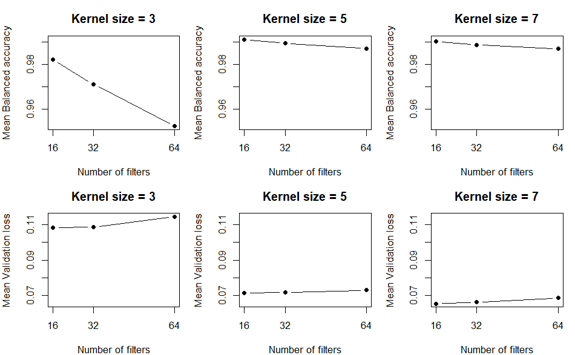

# Siamese Neural Network
## Methods

### General Siamese structure and loss function

* Input: 2 or 3 images
* Output: distance between embeddings of images
* Distance infers similarity
* High distance - images dissimilar (different writers)
* Low distance - similar images (same writer)

* Constrastive loss:

$$L = yD^2 + (1-y)max(0, m-D)^2$$

### Input pairs

* Training:  sessions 1, 2, 3
* Validation: session 4 
* Test: sessions 1 - 5
* ((((((((((pair probs))))))))))
* ((((((((((batches))))))))))

### Metrics  

* $$\text{Sensitivity} = \frac{\text{True Positives}}{\text{True Positives + False Negatives}}$$

* $$\text{Specificity} = \frac{\text{True Negatives}}{\text{True Negatives + False Positives}} $$

* $$\text{Balanced Accuracy} = \frac{\text{Sensitivity + Specificity}}{2}$$

### Tuning

* Hidden layers
* Activation functions
* Filter (square) size 
* Number of filters
* Other (fixed) inputs

## Results

### Tuning hidden layers

| Number of Hidden Layers | Validation Loss | Balanced Accuracy |
|------------------------:|---------------------:|-----------------------:|
| 1                       |                0.214 |                  0.773 |
| 2                       |                0.105 |                  0.966 |

### Tuning activation functions

| Activation Functions | Validation Loss | Balanced Accuracy |
|:---------------------|----------------:|------------------:|
| relu_relu            |           0.105 |             0.966 |
| tanh_relu            |           0.103 |             0.971 |
| relu_tanh            |           0.108 |             0.982 |
| tanh_tanh            |           0.113 |             0.980 |

### Tuning filter numbers and size 

 {#fig-siamese-error2 width="100%"}

### Tuning filter numbers and size 

| Number of Filters | Kernel Size | Validation Loss | Balanced Accuracy |
|------------------:|------------:|----------------:|------------------:|
| 16                | 3           |           0.108 |             0.982 |
| 32                | 3           |           0.109 |             0.971 |
| 64                | 3           |           0.115 |             0.952 |
| 16                | 5           |           0.071 |             0.991 |
| 32                | 5           |           0.072 |             0.989 |
| 64                | 5           |           0.073 |             0.987 |
| 16                | 7           |           0.065 |             0.990 |
| 32                | 7           |           0.066 |             0.989 |
| 64                | 7           |           0.068 |             0.987 |

### Final model 

* Inputs
* Overall performance
* Session results

| Session Type      |    n | Accuracy | Sensitivity | Specificity | Balanced Accuracy |
|:------------------|-----:|---------:|------------:|------------:|------------------:|
| Same      | 2000 |    0.947 |       0.899 |       0.995 |             0.947 |
| Different | 2000 |    0.554 |       0.112 |       0.997 |             0.554 |

### Session x writer results

| Pair Type                          |    n | Correct | Accuracy |
|:-----------------------------------|-----:|--------:|---------:|
| Same writer, same session          | 1000 |     899 |    0.899 |
| Same writer, different session     | 1000 |     112 |    0.112 |
| Different writer, same session     | 1000 |     995 |    0.995 |
| Different writer, different session| 1000 |     997 |    0.997 |

### Digit results

| Digit | Accuracy | Sensitivity | Specificity | Balanced Accuracy |
|------:|---------:|------------:|------------:|-------------------:|
| 0     | 0.742    | 0.501       | 0.995       | 0.748              |
| 1     | 0.765    | 0.532       | 0.995       | 0.763              |
| 2     | 0.763    | 0.513       | 0.998       | 0.755              |
| 3     | 0.742    | 0.476       | 1.000       | 0.738              |
| 4     | 0.743    | 0.510       | 0.992       | 0.751              |

### Writer results (1 - 10)

| Writer |   n | Accuracy | Sensitivity | Specificity | Balanced Accuracy |
|-------:|----:|---------:|------------:|------------:|------------------:|
| 1      | 212 |    0.769 |       0.538 |       0.991 |             0.765 |
| 2      | 177 |    0.718 |       0.432 |       1.000 |             0.716 |
| 3      | 218 |    0.752 |       0.481 |       1.000 |             0.740 |
| 4      | 216 |    0.750 |       0.518 |       1.000 |             0.759 |
| 5      | 168 |    0.732 |       0.476 |       0.988 |             0.732 |
| 6      | 210 |    0.710 |       0.444 |       0.990 |             0.717 |
| 7      | 182 |    0.791 |       0.587 |       1.000 |             0.793 |
| 8      | 216 |    0.718 |       0.429 |       0.991 |             0.710 |
| 9      | 187 |    0.775 |       0.523 |       1.000 |             0.761 |
| 10     | 198 |    0.783 |       0.557 |       1.000 |             0.778 |

### Writer results (11 - 20)

| Writer |   n | Accuracy | Sensitivity | Specificity | Balanced Accuracy |
|-------:|----:|---------:|------------:|------------:|------------------:|
| 11     | 204 |    0.750 |       0.495 |       1.000 |             0.748 |
| 12     | 197 |    0.751 |       0.520 |       1.000 |             0.760 |
| 13     | 232 |    0.690 |       0.403 |       0.991 |             0.697 |
| 14     | 249 |    0.711 |       0.453 |       0.983 |             0.718 |
| 15     | 186 |    0.747 |       0.484 |       1.000 |             0.742 |
| 16     | 170 |    0.782 |       0.543 |       1.000 |             0.772 |
| 17     | 161 |    0.758 |       0.542 |       0.987 |             0.765 |
| 18     | 218 |    0.803 |       0.613 |       1.000 |             0.806 |
| 19     | 212 |    0.778 |       0.557 |       1.000 |             0.778 |
| 20     | 187 |    0.770 |       0.552 |       1.000 |             0.776 |